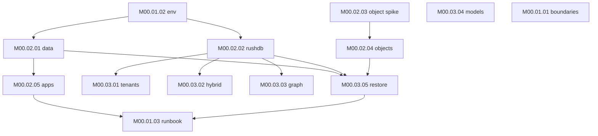

# Dependency Graph

Source of truth for task definitions: [`docs/plan/TASK_INDEX.csv`](../plan/TASK_INDEX.csv) (108 leaf tasks).
This file adds the **practical** dependencies the coordinator enforces on top of the declared ones. Each one is
recorded with a reason. Changes to it are logged in [`DECISION_CHANGES.md`](DECISION_CHANGES.md).

## Milestone gates (declared)


Every M01+ task declares only "`Mxx` exit gate". Per the master prompt, tasks may start early **only** when their
prerequisites and integration contracts are stable. Early starts are listed under "Early-start candidates" and need
coordinator sign-off.

### Exit-gate definitions (coordinator interpretation, DC-007)
- **M00 exit gate:** all 13 M00 tasks DONE, **and** the RushDB PoC verdict (M00.03.01–03) is GO, **and** the
  object-store choice (M00.02.03) is accepted. A NO-GO on RushDB means an architecture change, which needs the
  user's approval before M03 work depends on RushDB.
- **Mxx exit gate (xx ≥ 01):** all tasks in the milestone DONE with acceptance evidence recorded in
  `AGENT_HANDOFFS.md`.

## M00 — practical dependencies

The spec lists `None` for every M00 task. Tests cannot pass without the services they exercise, so:

| Task | Practical prerequisite | Reason |
|---|---|---|
| M00.01.01 boundaries | — | docs only |
| M00.01.02 env contract | — | shared contract, written first by coordinator |
| M00.02.01 data.yml | M00.01.02 | consumes env names |
| M00.02.02 rushdb.yml | M00.01.02 | consumes env names |
| M00.02.03 object-store spike | — | evaluation |
| M00.02.04 objects.yml | M00.02.03 | composes the chosen provider |
| M00.02.05 apps.yml + starters | M00.01.02, M00.02.01 | API health checks DB/Redis reachability |
| M00.03.01 tenant spike | M00.02.02 | needs a running RushDB |
| M00.03.02 hybrid spike | M00.02.02 | needs a running RushDB |
| M00.03.03 graph spike | M00.02.02 | needs a running RushDB |
| M00.03.04 local models | — | independent (uses Docker GPU or CPU) |
| M00.03.05 restore smoke | M00.02.01, M00.02.02, M00.02.04 | backs up/restores all three stores |
| M00.01.03 runbook | M00.02.01–05 | documents real, tested commands |



**Critical path:** env → rushdb.yml → tenant/hybrid/graph spikes → RushDB GO/NO-GO → M00 exit gate.
M03.03.x (publication), M04 (retrieval) and M05 (graph) all depend on that verdict.

## Declared intra-milestone chains (M03)

```
M03.01.01 → M03.01.02 → M03.01.03 → M03.01.04
M03.02.01 → M03.02.02 → M03.02.03 → M03.02.04 → M03.02.05
M03.03.01 → M03.03.02 → M03.03.03 → M03.03.04 → M03.03.05
```

## Ownership conflicts (must serialize)

| Path | Tasks | Resolution |
|---|---|---|
| `apps/api/migrations/versions/` | M01.02.01, M02.02.01 (+ every later schema change) | Single migration owner (coordinator). Revisions are linear; never two migration tasks in flight. |
| `tests/evaluation/` ⊃ `datasets/`, `graph/` | M04.03.05 ⊃ M04.03.04, M05.03.04 | Parent owns only files not under a child path. |
| `apps/api/app/modules/ingestion/processors/` ⊃ `spreadsheet.py`, `code.py`, `image.py`, `audio.py`, `video.py` | M03.02.02 ⊃ M06.02.01–05 | M03.02.02 owns the registry and PDF/TXT/MD/HTML; M06 tasks own their single file and register via the documented hook. |
| `apps/web/src/features/evidence/` ⊃ `renderers/` | M04.03.03 ⊃ M07.03.02 | as above |
| `apps/web/src/features/knowledge-graph/` ⊃ `evidence/` | M05.03.02 ⊃ M05.03.03 | as above; same milestone, so run sequentially |
| Root `compose.yaml`, `pyproject.toml`, `package.json`, `.github/` | unowned in spec | Integration owner (coordinator). Agents request changes in their handoff. |

## Early-start candidates (after M00 exit gate)
Contract/document tasks with no runtime dependency on unfinished milestones may start early with sign-off:
M05.01.01 (ontology doc), M03.02.01 (extracted-content contract), M02.01.01 (storage port), M04.03.04 (golden dataset).
